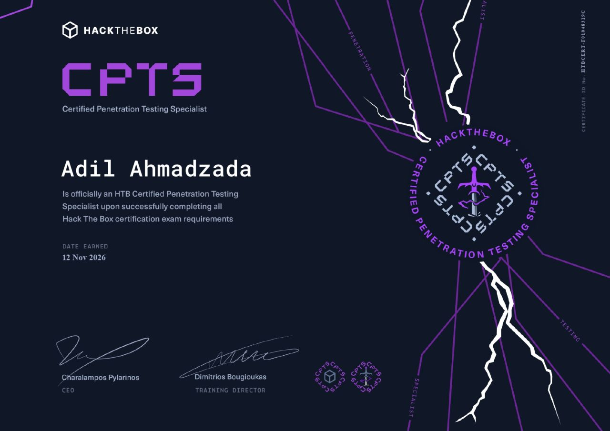

today I want share my experience about HTB CPTS certification. hope this blog finds u well.

okay lets start from the beginning.

## Background

before CPTS I had CompTIA PenTest+ and im in my 4th year of BSc in Information Security. this was my first hands-on exam like this, never did a long journey like this before.

## The Journey

took me about a year. I wrote all my notes in Obsidian, synced via Git and Syncthing, also read them during public transport on my phone.

I did the modules slowly, at least 1 hour each day. sometimes there wasnt time during the week so I made up for it on weekends.

kept this pace until September 2026 for the Academy side. after September I started doing machines, full list at the end. also 1 week before the exam I did HTB Pro Lab **Dante**. not necessary but I did it to feed my confidence.

Dante is easier than CPTS btw. no deep rabbit holes compared to CPTS.

all the Academy modules are important but if u want to prioritize, **AD Enumeration** and **Enumeration of Services** is what u really need for the exam.

## The Exam

exam is 10 days. u get several machines, u need to pwn all of them and before the end of 10 days write a commercial pentest report and submit it.

I started on Saturday and in 5 days already fully pwned everything. if u struggle in the exam, do ur research and always go back to Academy modules before going deep. check what they taught u, maybe u are missing something. thats exactly what I did and it helped me hit the 8th flag. yeah the 8th flag.. its the difficult one. the difficulty comes from the chain, u need the mindset to combine things and think outside the box.

## The Report

report was the easy part because I was taking notes and screenshots while pwning.

I used **SysReptor** with the CPTS template, also created findings templates that ill share with u:
[sysreptor-cpts-kit](https://github.com/adilaxmdv/sysreptor-cpts-kit)

also used **ShareX** for taking screenshots from Windows.

## My Setup

- VMware + Kali 2026
- Lenovo ThinkPad T14 Gen 6, 32GB RAM, 1TB SSD

## Tools I Recommend

- **Ligolo-ng** - best thing u should learn, u need to feel confident with tunneling and pivoting
- **BloodHound-CE** - for playing with collected AD data
- **RustHound-CE** - for collecting data in AD environments
- **NetExec** - really the best tool ever u can use it for everything
- **Impacket** - I dont think I need to say anything about this one

## Final Thoughts

I really recommend this cert and path. not because it can easily get u a job (maybe idk) but it gives u real hands-on experience with writing a commercial report and actual pentesting.

## Machines I Did Before the Exam

**Easy**
- Postman, Trick, Active, Forest, Sauna, Support, Cicada, EscapeTwo, Fluffy, MetaTwo, Soccer, Pandora, Headless, BountyHunter, TwoMillion, Love

**Medium**
- Administrator, Media, TombWatcher, Voleur, POV, Certified, Escape, Manager, Authority, VulnCicada, StreamIO, Jeeves, Builder, Hospital, Craft, Agile, Magic, SecNotes, RedCross, Hawk

**Hard**
- Blackfield, Redelegate, Flight

---

